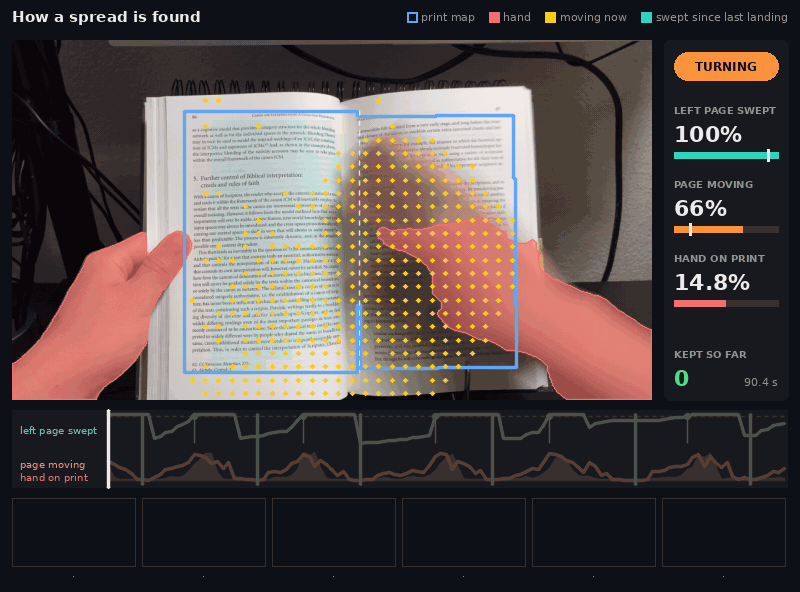
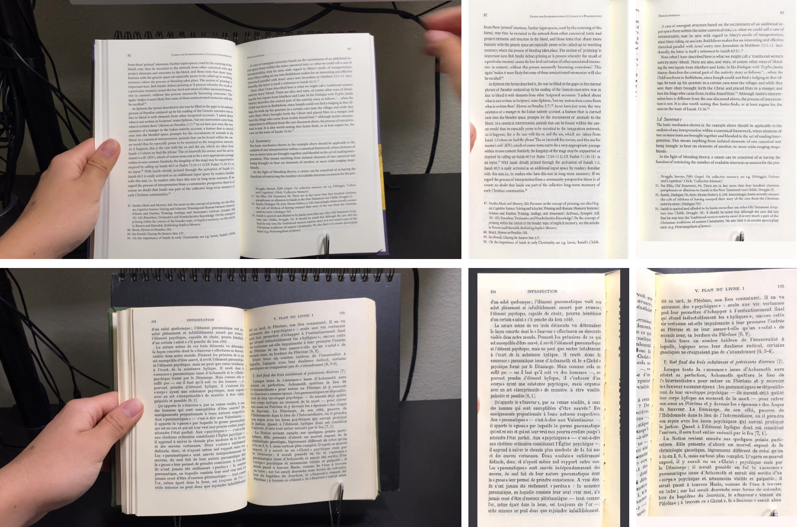
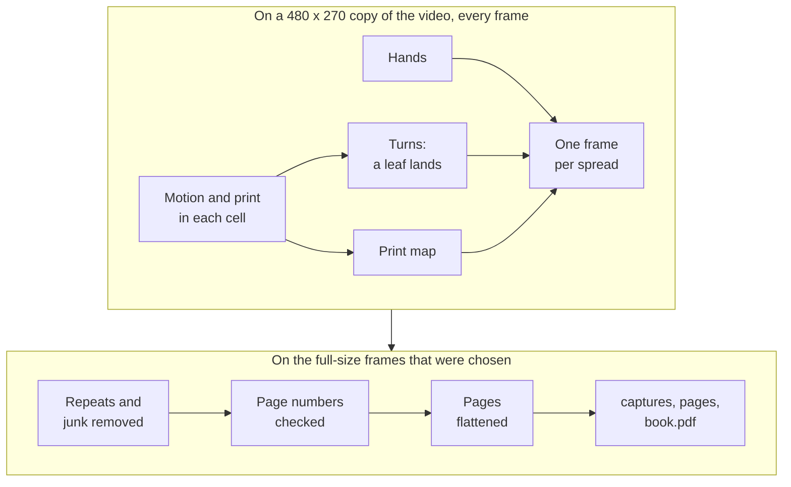
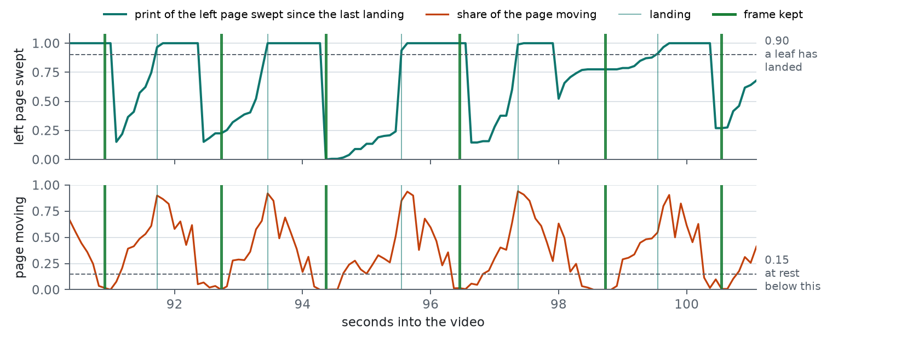
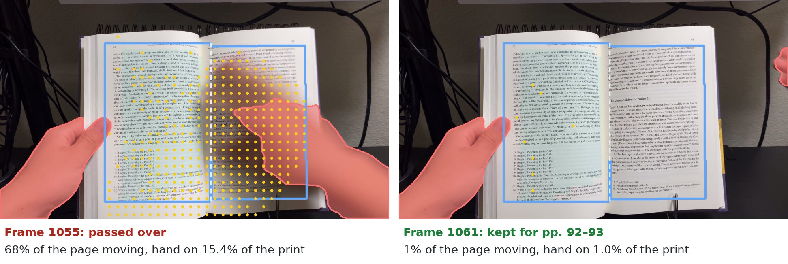
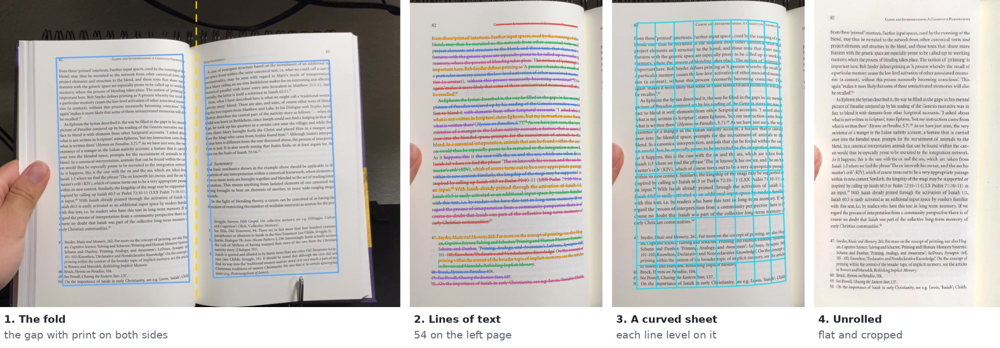

# Auto Camera

**Scan a book by filming it.** Point a fixed camera at a book, turn the pages,
and get back one clean photograph of every two-page spread, each page
flattened and cropped, and a searchable PDF.



*Eleven seconds of a real recording, played back with what the pipeline
measured on it. Teal: print on the left page that a turning leaf has swept
over since the last landing. Yellow dots: cells moving right now. Red: hands.
Blue: where this book's print lies. Green: the one frame kept for each spread.
[The same as an MP4](docs/media/demo.mp4).*

[Try it in a browser](https://video.paulantir.com) ·
[How it works](#how-it-works) ·
[Results](#results) ·
[Quick start](#quick-start)

## Why

Turning a page takes two seconds, so a 300-page book is filmed in five
minutes. The video already holds every page; the work is choosing.

At 11 frames a second each spread is on screen for about twenty frames. Most
of them show a leaf in the air, a hand across the text, or blur. Readers also
turn two leaves at once, flip back, press a springy page down several times,
and rest a thumb on the page number. The pipeline has to keep exactly one frame
per spread, the sharpest and stillest one with nothing over the print, without
skipping a spread and without keeping one twice.

The acceptance test is the book's own page numbers: read off the kept frames,
they have to run on without a gap.

## What you get

For each video, one folder:

| | |
| --- | --- |
| `captures/` | One full-resolution still per spread, in page order. |
| `pages/` | Each page on its own: flattened, straightened, cropped. |
| `book.pdf`, `book.txt` | The pages as a PDF, searchable when Tesseract is installed. |
| `needs_review.txt`, `review/` | The captures worth a second look, and contact sheets of everything. |
| `audit.json` | The printed page numbers read from every capture, and any gap or repeat in their sequence. |



*Two captures, and the pages made from them.*

## How it works



### 1. Find the print

One pass over the small copy stores, for every frame, a thumbnail and a
fine-detail value for each 10 x 10 pixel cell. A cell holds print on a turned
page when its detail is usually strong and regularly collapses for a few
frames: a leaf passing over it is a blur. A textured wall or a pen cup is just
as detailed and never does that. The *print map* (blue in the pictures) is
where frames at rest show fine detail that changes from spread to spread.

No page corners are clicked, no region is drawn, and nothing is tuned to a
book. Thresholds that have to differ between videos are measured from the
video.

### 2. Find the turns

A turn ends with a leaf landing on the left page. Motion over the left page's
print cells is accumulated; when 90% of them have been swept and the page next
comes to rest, that is one landing, and a new spread begins. The level was
measured: at 70% a hand pressing the page flat counted as a turn. A leaf that
slows down in the air and sweeps the page a second time within three frames is
still one landing.



*The same eleven seconds as the animation. Each landing (thin line) starts a
new spread; the frame kept (thick green line) lies where the page is at rest.*

### 3. Choose one frame per spread

Between two landings only calm frames are eligible. Among those at least 60%
as sharp as the sharpest, the frame with the least print under a hand wins,
then the least hand anywhere on the page, then the sharpest and stillest.

Hands come from two MediaPipe models run on every frame: a skin segmenter and
a hand landmarker. A patch of skin counts as a hand when it reaches the edge
of the picture (a hand is on an arm) or holds a palm the landmarker found.
A sepia portrait or lamp-lit paper in the middle of the page does not.



*Six frames apart. On the left a hand sweeps the new page flat and two thirds
of the page are moving. On the right the page is at rest; the thumb that holds
the book is in every frame of this spread, so only hand beyond that counts.*

### 4. Drop repeats and junk

Two consecutive candidates are the same spread only when both pages match by
keypoints. A frame caught mid-turn shares its left page with one spread and
its right page with the next, which is how it is recognised and dropped. Of
several views of a spread that never comes to rest, the best is kept, not the
first.
Captures with no paper in the page region (a cover, the empty stand) are
trimmed from the start and the end.

### 5. Check the printed page numbers

OCR reads the page numbers in each capture, and a decoder fits the sequence. A
capture that repeats the number seen just before, in the same place, is
removed. This step only ever removes, and never next to a gap: a missing page
is worse than a repeated one.

### 6. Flatten the pages

Each capture is split at the fold. On each half the lines of text are found,
and a curved sheet seen through a pinhole camera is fitted to them so that
every line of text is level on the sheet. The sheet is then unrolled flat and
cropped to its print.



The sheet model is the one in Matt Zucker's
[page_dewarp](https://github.com/mzucker/page_dewarp), solved here as a sparse
least-squares problem. A page without lines of text (a plate, a title page) is
cut out straight.

### 7. Make the book

Tesseract reads the pages and writes a searchable PDF. A page whose text
repeats a page near it is left out of the PDF when the other copy reads
better and its picture is no worse; otherwise both stay.

## Results

Measured on 48 recordings (7.65 hours, 8,293 spreads kept, 16,509 pages) of
books in English, German, French, Latin and Greek, filmed on different stands
under different light. The videos were split into 34 for development and 14
held out before any of the work.

| | Development | Held out |
| --- | ---: | ---: |
| Videos | 34 | 14 |
| Videos whose page numbers can be read | 31 | 13 |
| Numbered spreads in those | 5,047 | 2,415 |
| Spreads missing | 13 (0.26%) | 3 (0.12%) |
| Captures that repeat a spread | 51 (0.9%) | 19 (0.7%) |
| Videos with no gap at all | 28 of 31 | 12 of 13 |

- **Missing.** Five of the 16 were never filmed: the reader turned two leaves
  and did not go back. The other 11 are in two books whose numbering changes
  partway through, which the decoder does not follow.
- **Clean.** A vision model shown every capture calls 93% of them clean.
  Checked against 172 captures labelled by eye, it over-counts hands by about
  a quarter, mostly the holding thumb lying on the margin.
- **Speed.** A 250-second video of a 232-page book takes 12 minutes end to end
  on a desktop held to four CPU cores, with a GTX 1660 Ti: 4 minutes to choose
  the 116 frames, under a minute to read the page numbers, and 7 minutes to
  flatten the pages and read them in seven languages for the PDF.

The held-out videos were scored after every version, so these are not
unseen-data figures; the held-out results moved the same way as the
development results each time.

## Quick start

Python 3.12 and FFmpeg on the PATH.

```bash
git clone https://github.com/paulantir0/auto-camera.git
cd auto-camera
python3 -m venv .venv && .venv/bin/python -m pip install -r requirements.txt

# the two hand models, 8 and 16 MB, from Google's MediaPipe model storage
mkdir -p data/models
curl -L -o data/models/hand_landmarker.task https://storage.googleapis.com/mediapipe-models/hand_landmarker/hand_landmarker/float16/latest/hand_landmarker.task
curl -L -o data/models/selfie_multiclass_256x256.tflite https://storage.googleapis.com/mediapipe-models/image_segmenter/selfie_multiclass_256x256/float32/latest/selfie_multiclass_256x256.tflite

# one video, end to end
.venv/bin/python tools/run_video.py my-book.mov --run out/
```

The results are in `out/my-book/`. Add `--no-gpu` on a machine without an
NVIDIA card; the results are the same, more slowly.

Two optional parts:

```bash
# a searchable PDF (without Tesseract the PDF holds the page images only)
sudo apt install tesseract-ocr tesseract-ocr-eng tesseract-ocr-fra tesseract-ocr-deu tesseract-ocr-lat tesseract-ocr-grc tesseract-ocr-ell tesseract-ocr-ita

# the printed-page-number check, in its own environment
python3 -m venv .venv-ocr && .venv-ocr/bin/pip install rapidocr-onnxruntime
```

From Python:

```python
from pathlib import Path
from auto_camera.pipeline import run_video

result = run_video(Path("my-book.mov"), Path("out"), use_gpu=False)
```

**Filming.** A fixed camera facing a book held open on a stand, the whole
spread in the picture. The recordings this was built on are 11 fps HEVC at
3072 x 1728 or 3840 x 2160. Let each spread lie still for a moment with both
hands off the print; that single habit matters more than the stand or the
light.

## Other ways to run it

| | |
| --- | --- |
| **In a browser, nothing installed** | [video.paulantir.com](https://video.paulantir.com). The video is decoded and processed in the browser and never leaves the computer. Its code is in [`web/`](web/). |
| **A local web page** | `.venv/bin/python tools/web_app.py` starts a small server on the computer it is run on; open `http://127.0.0.1:8770/` in a browser there. It answers that computer only. Started with `--lan` it also answers the home network, without a login. |
| **A desktop window** | `python auto_camera_gui.py`. A GitHub Actions workflow builds a Windows exe from it; that build has not been run yet. See [docs/desktop-app.md](docs/desktop-app.md). |

## What is in the repository

| Path | What it is |
| --- | --- |
| `auto_camera/` | The pipeline; `pipeline.py` is the entry point. |
| `tools/run_video.py` | One video, end to end, from the command line. |
| `webapp/`, `tools/web_app.py` | The local web page: a window onto the pipeline in a browser on the same computer. |
| `web/` | The version that runs entirely in a browser; it has [its own README](web/README.md). |
| `auto_camera_gui.py` | The desktop app. |
| `tests/` | Unit tests; none needs a video: `.venv/bin/python -m unittest discover -s tests`. |

## Limits

- A spread shown for half a second with a hand across it is recorded by its
  least bad frame and listed for review.
- Pages the reader skipped are not in the video and are not in the book. The
  audit names them.
- A book without readable page numbers keeps its repeats: about one capture in
  twenty is then a second view of a spread.
- About 20 covers and empty-stand frames remain among the first and last
  captures of the 48 books.
- A fingertip over the first letters of a line cannot be told from a thumb on
  the margin beside it: on the small copy a letter is two or three pixels.
- The flattening bends the sheet from left to right only. A page that also
  sags from top to bottom keeps some of that, and a capture taken in the
  middle of a turn gives a curled page.
- Built and measured on 11 fps landscape video from a fixed camera. Other
  frame rates, portrait video and moving cameras are untested.

## Acknowledgements

[MediaPipe](https://developers.google.com/mediapipe) for the hand landmarker
and the skin segmenter, [page_dewarp](https://github.com/mzucker/page_dewarp)
for the curved-sheet model, [Tesseract](https://github.com/tesseract-ocr/tesseract)
and [RapidOCR](https://github.com/RapidAI/RapidOCR) for reading,
[OpenCV](https://opencv.org) and [FFmpeg](https://ffmpeg.org) for nearly
everything else.

## Licence

[MIT](LICENSE).
